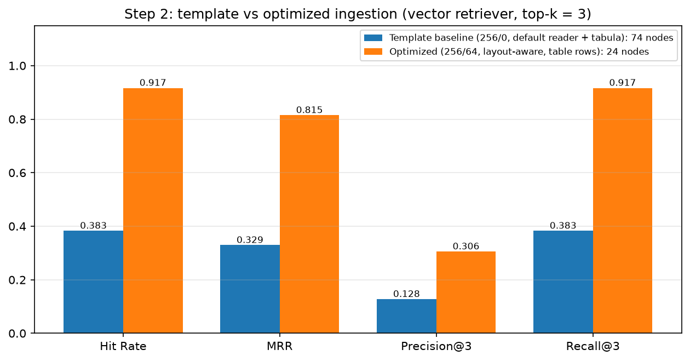
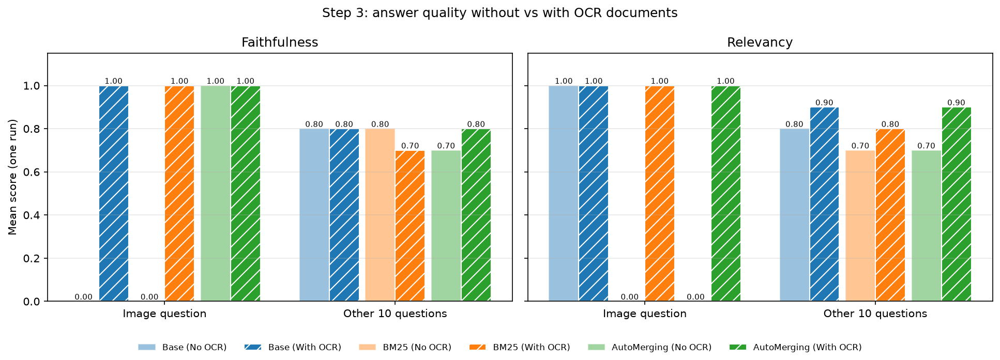
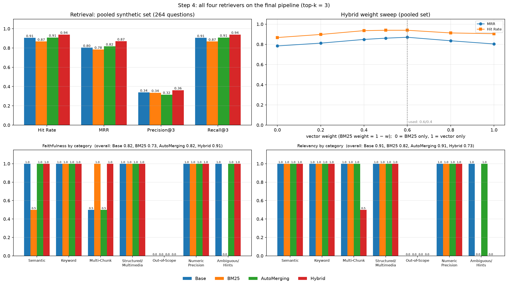
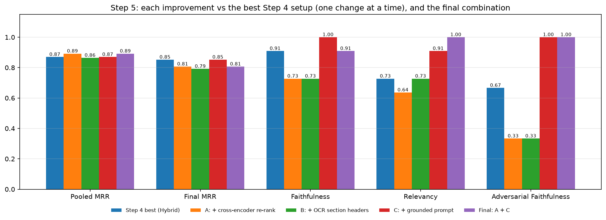

# Question Answering over a PDF with RAG

## What this project is about

A retrieval-augmented generation (RAG) system that answers questions about one real, messy document: *WebMD Real Stories: Chronic Migraine*, a magazine-style PDF with two-column pages, side boxes, a table, decorative fonts and an infographic that exists only as an image.

The project starts from a standard LlamaIndex pipeline, measures where it fails, and fixes each stage in turn: the evaluation set, parsing, OCR, retrieval and generation. Each change is tested on its own and kept only if it improves a measure fixed in advance.

Topics covered:
- Building a RAG test set by hand, with categories that stress different parts of the pipeline
- Debugging a retriever that ran without errors but did nothing (auto-merging without a node hierarchy)
- Layout-aware PDF parsing: reading order with XY-cut, garbled fonts, tables as sentences
- Chunk-size and overlap experiments, and why the standard retrieval metric can mislead
- OCR for image-only content, with filters that keep only what the text layer missed
- Hybrid retrieval (vector + BM25 with weighted score fusion) and cross-encoder re-ranking
- Grounded prompting, so the model says when the document has no answer
- Evaluation with LLM judges (faithfulness, relevancy), hit rate and MRR, plus hand checks of judge mistakes

Sections 1 to 6 of the notebook set up a provided LlamaIndex RAG template (loading, indexing, three retrievers, evaluation helpers). Steps 1 to 5, the experiments and all analysis are my work.

## The pipeline

```
PDF ──► layout-aware loader (pdfplumber) ──┐
   └──► OCR of rendered pages (EasyOCR) ───┴──► 256-token chunks, overlap 64
                                                   │
                                                   ▼
                       vector (all-MiniLM-L6-v2) + BM25, 10 candidates each
                                                   │
                              weighted fusion 0.6 / 0.4 ──► cross-encoder re-rank to top 3
                                                   │
                                                   ▼
                         answer LLM (mistralai/mistral-nemo) with a grounded prompt
                                                   │
                                                   ▼
                judge LLM (deepseek-v4-flash): faithfulness and relevancy
```

Both LLMs are called through OpenRouter. Embeddings, BM25, OCR and the re-ranker run locally.

## The test set

`test_questions.txt` holds 11 questions I wrote after reading the whole PDF, including its images. Each line is `category | question | expected answer`, and each category targets a different weakness:

| Category | Questions | What it tests |
|---|---|---|
| Semantic | 2 | Answers worded differently from the question |
| Keyword-Heavy | 2 | Rare terms such as drug names |
| Multi-Chunk | 2 | Answers spread over several sections |
| Structured/Multimedia | 2 | One table question, one question answered only by an infographic |
| Out-of-Scope | 1 | A question the document cannot answer (a drug's price) |
| Numeric Precision | 1 | Exact percentages |
| Ambiguous/Hints | 1 | A question that tempts the model to add outside knowledge |

For retrieval metrics I also generated synthetic question sets with `generate_question_context_pairs`, using a stricter prompt than the default (the default produced multiple-choice lines as "questions"). All generated datasets and LLM answers are cached, so the notebook re-runs without repeating API calls.

## How I approached it

### Step 1: Baseline, and a retriever that never worked

I ran the template's three retrievers (vector, BM25, auto-merging), all with top-k 3 so they compete on equal terms.

**The bug.** The auto-merging retriever is supposed to replace several small chunks with their larger parent. But the template built flat chunks with `SentenceSplitter`, so no chunk had a parent: 0 of 74 nodes had one, and auto-merging returned exactly the same chunks as the plain vector retriever on 11 of 11 questions. It ran without errors and did nothing. **The fix:** a `HierarchicalNodeParser` with 1024 / 512 / 256-token levels, all levels in the docstore, only the leaves indexed. Merges then happened on 7 of 11 questions.

**What the baseline showed:** keyword and numeric questions worked for every retriever, the infographic question failed for all of them (the answer exists only as pixels), and every retriever claimed migraine "runs in families", which the document never says.

### Step 2: Fixing ingestion

I profiled each page and looked at what the default reader produced. It was the biggest problem in the pipeline:
- **Two-column pages** were read line by line across both columns, mixing unrelated stories into one chunk.
- **Fonts without a Unicode map** (headings, contents page, a tips box) came out as symbol strings like `/gid00020...`. 42 of the 74 default chunks were more than 30% of this garbage, and 74 of the 128 synthetic questions were generated from it ("What is the sequence of group IDs in the first part of the context?").
- **The one real table** became a markdown blob with cells far from their row and column names.

My **layout-aware loader** (pdfplumber):
- **Reading order with recursive XY-cut:** split at the widest empty vertical gap first (columns, left to right), otherwise at the largest horizontal gap (blocks, top to bottom). Running headers and footers are removed before the cut, because a full-width footer hides the gap between columns.
- **Noise removal:** characters from garbled fonts (detected by their letter/digit ratio), rotated photo credits, characters printed twice, `(cid:N)` codes and repeated footers.
- **Tables as sentences:** each row becomes one self-contained sentence (`Headache Type: Migraine. Location: Unilateral. ...`), so a chunk never holds a cell without its column name.
- **Stable IDs** for every document and chunk, so cached synthetic datasets stay valid on re-runs.

**Chunking experiments.** Chunk size 64 / 128 / 256 / 512, then overlap and splitting variants at the chosen size, one change at a time. The standard metric counts a hit only if the exact source chunk comes back, which favours large chunks (fewer, easier targets) and counts an overlapping neighbour with the same answer as a miss. So I added a **pooled cross-check**: all 264 questions from the four chunk-size datasets are asked of every configuration, and a retrieved chunk counts as relevant if it shares at least half of its word trigrams with the source chunk. Because relevance is judged on text, this also compares pipelines with different chunks.

Decisions: 256-token chunks (best on both measures), overlap 64 (pooled MRR 0.841 vs 0.764 without overlap), sentence splitting instead of paragraph splitting (paragraphs lowered pooled MRR to 0.783), and table rows as sentences (the markdown table lowered pooled hit rate from 0.924 to 0.818).



### Step 3: OCR for what the text layer cannot see

The infographic with the four migraine stages, the cover, and the text in garbled fonts are invisible to text extraction. I rendered every page at 200 dpi with PyMuPDF and ran EasyOCR with paragraph grouping (cached, since OCR takes about 10 seconds per page on a CPU).

Full-page OCR also re-reads every paragraph that was already extracted, and those duplicates would compete for the same top-3 slots. So each OCR block passes two filters:
- **Novelty:** dropped if at least 90% of its words, or (for 3+ words) at least 50% of its word trigrams, already occur in that page's text layer.
- **Junk:** dropped if it has fewer than two words of 3+ letters, or is a running footer.

The kept blocks become one document per page, tagged as OCR.

**Result:** the infographic question went from wrong to correct for all three retrievers. Without OCR they answered from general knowledge ("aura usually lasts 20 to 60 minutes" instead of the graphic's "five to 60 minutes"). The cost, measured on the 264 text questions: vector MRR 0.841 to 0.804, and 5 questions lost their correct chunk to an OCR chunk. I kept all OCR documents and treat this as a trade-off.



### Step 4: Hybrid retrieval

Vector search and BM25 fail on different questions. BM25 wins when the question repeats the document's exact words (table column names, drug names); vector search wins when the wording differs. The hybrid:
- Vector and BM25 retrievers each return 10 candidates.
- `QueryFusionRetriever` in `relative_score` mode scales each list's scores to [0, 1], weights them 0.6 / 0.4, and adds the scores of chunks found by both.
- No LLM-generated query variants (`num_queries=1`), so this measures hybrid retrieval, not query expansion.
- Final top-k 3, the same as every other retriever.

A weight sweep on the pooled questions peaked at 0.6 (MRR 0.870), with 0.5 almost as good (0.861), so the result is not sensitive near the middle.



### Step 5: Three improvements, one at a time

Each change was compared with the hybrid. The keep rules were fixed before seeing results: a retrieval change is kept if it raises pooled MRR; the prompt is kept if it raises faithfulness without lowering relevancy by more than one question.

- **A. Cross-encoder re-ranking** (`cross-encoder/ms-marco-MiniLM-L-6-v2`): the hybrid returns 10 candidates, the cross-encoder reads each question and chunk together, and the top 3 are kept. Pooled MRR rose from 0.870 to 0.892, but MRR on the smaller 44-question set fell from 0.852 to 0.807. Kept by the rule, with that disagreement stated. Retrieval time per query went from about 5 ms to about 50 ms, still small next to the LLM call.
- **B. Section headers from OCR** added to each chunk's embedded metadata, so a chunk like "it should bring improvements in four areas" carries its section name. Not kept: pooled MRR 0.864. The headings are coarse (one or two per page), so chunks on the same page became more alike.
- **C. Grounded prompt.** The default prompt says to use no prior knowledge, but Mistral-Nemo ignored it. The new prompt states the rules explicitly, gives an exact sentence to use when the document has no answer, and asks for numbers to be copied exactly. Faithfulness went from 0.909 to 1.000. The model now says "The document does not provide information about the cost of VYEPTI with insurance" instead of deflecting, and it no longer claims a "genetic component".



## Results

**Ingestion** (vector retriever, top-k 3, each pipeline's own synthetic questions):

| Pipeline | Chunks | Hit rate | MRR |
|---|---|---|---|
| Default reader + tabula, 256 tokens, no overlap | 74 | 0.383 | 0.329 |
| Layout-aware loader + table rows, 256 tokens, overlap 64 | 24 | 0.917 | 0.815 |

On one shared set of 264 questions, MRR rose from 0.556 to 0.841.

**Retrievers** on the final pipeline (264 pooled questions):

| Retriever | Hit rate | MRR |
|---|---|---|
| Vector | 0.905 | 0.804 |
| BM25 | 0.867 | 0.784 |
| Auto-merging (fixed) | 0.909 | 0.818 |
| Hybrid 0.6 / 0.4 | 0.939 | 0.870 |
| Hybrid + cross-encoder re-rank | 0.947 | 0.892 |

**Answer quality** (11 test questions, binary judges):

| System | Faithfulness | Relevancy |
|---|---|---|
| Template baseline, vector retriever | 0.636 | 0.545 |
| Hybrid on the final pipeline | 0.909 | 0.727 |
| Final: hybrid + re-rank + grounded prompt | 0.909 | 1.000 |

What the numbers say:
- **Most of the gain came from parsing, not from retrieval tricks.** Clean, correctly ordered text took hit rate from 0.38 to 0.92 before any retriever change.
- **Retrieval was close to its limit by Step 4** (hit rate about 0.94), so the remaining errors came from generation, and the prompt change helped more than either retrieval change.
- **The judge makes mistakes, so I checked answers by hand.** The final system's one faithfulness 0 is a judge error: every detail of that answer is in the retrieved chunks. Earlier, the judge gave faithfulness 1 to an answer that claimed a "genetic component" not in the document.
- **Limits:** 11 questions with binary judges, so one question moves an average by about 9 points, and each variant was run once. Retrieval metrics on 264 questions are the more reliable signal.

## Repository layout

```
pdf_rag_qa.ipynb      the full pipeline, experiments and analysis, with outputs
test_questions.txt    11 hand-written questions with expected answers
results/              cached answers and judge scores per experiment (CSV)
figures/              charts produced by the notebook
requirements.txt
.env.example
```

## How to run

1. Python 3.12 and Java (tabula-py needs it).
2. Install the dependencies:
   ```bash
   python3.12 -m venv .venv && source .venv/bin/activate
   pip install -r requirements.txt
   ```
3. Get the PDF *WebMD Real Stories: Chronic Migraine* (Winter 2025) and save it as `WebMD.pdf` in the repository root. It is not included, because it is third-party content.
4. Copy `.env.example` to `.env` and add an [OpenRouter](https://openrouter.ai) API key.
5. Run `pdf_rag_qa.ipynb` from top to bottom.

The answer files in `results/` are reused, so a re-run does not repeat those LLM calls. The synthetic question sets (`datasets/`) and the OCR cache (`ocr_cache.json`) are not included, because they contain the PDF's text; the notebook rebuilds them on the first run, which takes several minutes and uses the API.

## Tech stack

Python, LlamaIndex 0.12, OpenRouter (Mistral-Nemo, DeepSeek), sentence-transformers (all-MiniLM-L6-v2, ms-marco cross-encoder), BM25 (bm25s, PyStemmer), pdfplumber, PyMuPDF, EasyOCR, tabula-py, pandas, Matplotlib.
